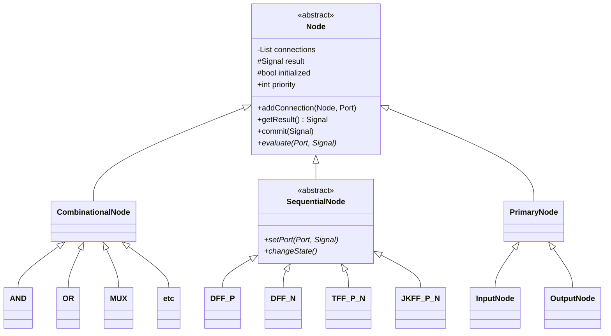

# Nodes and the circuit graph

Every cell in the netlist becomes one node, and so does every bit of a primary input or output. A wire is not an object of its own: it becomes a connection from its driving node to each node that reads it.

`etc` stands for NAND, NOR, XOR, NOT, ANDNOT and ORNOT. `TFF_P_N` and `JKFF_P_N` stand for the positive and negative edge classes, `TFF_P`, `TFF_N`, `JKFF_P` and `JKFF_N`.

## Basic types (`core/`)

| Type | Values |
|---|---|
| `Signal` | `LOW`, `HIGH` |
| `Port` | `O` (output), `A`, `B`, `S`, `J`, `K`, `D`, `T`, `CLK` |

The parser maps netlist port names onto `Port`: `C` → `CLK`, and `Y` and `Q` → `O`. The others keep their names.

## `Node`

| Member | Meaning |
|---|---|
| `result` | The node's current output |
| `connections` | The nodes this node drives, each with the port it drives on them. A singly linked list (`List`) |
| `priority` | Position in topological order, set by the parser. Lower values are committed first |
| `initialized` | Set by the first `commit`. Flip-flops use it to ignore clock changes during initialization |
| `evaluate(port, value)` | A new value has arrived on one input port. Each node type implements this |
| `commit(value)` | Passes `value` on: queues one `EvaluateOperation(target, port, value)` for each connection |

The split between `evaluate` and `commit` is the core of the design. `evaluate` updates a node's own output, and `commit` tells the rest of the circuit. The simulator decides when each node commits (see [simulation.md](simulation.md)).

## Combinational nodes

Each gate stores the last value seen on each of its input ports. `evaluate`:

1. stores the new input value,
2. recomputes the output,
3. if the output changed, stores it in `result` and adds the node to the topological queue.

The gate does not commit at that point. The topological queue holds each node at most once, so a gate whose inputs change several times in one wave is committed once, with its final value.

## Sequential nodes

A flip-flop stores its data inputs (`d`, `t`, or `j` and `k`) and the last clock level.

| Event | What happens |
|---|---|
| A data input changes | The value is stored immediately (`setPort`). Nothing is queued. |
| The clock moves to the active edge (`LOW→HIGH` for `_P`, `HIGH→LOW` for `_N`) | A `ChangeStateOperation` is added to the sequential queue. The stored clock level is updated when it runs. |
| The clock moves the other way | The new level is stored. |
| The clock changes before the node is initialized | Only the level is stored, so initialization never counts as an edge. |

`changeState()` computes the next state from the stored inputs:

| Class | Next Q |
|---|---|
| `DFF_P`, `DFF_N` | `d` |
| `TFF_P`, `TFF_N` | `t ? ¬Q : Q` |
| `JKFF_P`, `JKFF_N` | `00` hold, `01` 0, `10` 1, `11` ¬Q |

If Q changes, `changeState` adds a `CommitOperation` to the end of the sequential queue. This ordering is what makes all flip-flops update together (see [simulation.md](simulation.md#clock-edges)).

## Primary nodes

| Class | `evaluate` |
|---|---|
| `InputNode` | If the value changed, stores it and commits at once. `main.cpp` calls it to drive an input. The parser also uses an `InputNode` as the driver for each constant `1'0` / `1'1`. |
| `OutputNode` | Stores the value. It drives nothing, and `main.cpp` reads it with `getResult()`. |

## Operations (`operations/`)

| Operation | Queue | `run()` |
|---|---|---|
| `EvaluateOperation(node, port, value)` | combinational | `node.evaluate(port, value)` |
| `ChangeStateOperation(ff)` | sequential | `ff.changeState()` |
| `CommitOperation(ff)` | sequential | `ff.commit(ff.getResult())` |

`OperationQueue` is a FIFO of `unique_ptr<Operation>`, backed by a `std::deque`. `TopologicalQueue` is a `std::set<Node*>` ordered by `(priority, address)`. Adding a node that is already there does nothing, and `commitNext()` removes and commits the node with the lowest priority.

`OperationType.hpp` is left over from the old design (it still lists `SET_PORT`), and nothing uses it.

## Adding a cell type

1. Add a class under `include/<kind>/` and `src/<kind>/`, derived from `CombinationalNode` or `SequentialNode`, following an existing one.
2. If it needs a new port, add it to `Port` and to the parser's `portNameTable`.
3. Add its Yosys name and port list to `compTypeTable` in `src/parser/Parser.cpp`. A cell is treated as sequential when its port list contains `C`.
4. Add it to the tables in [formats/netlist.md](../formats/netlist.md) and this page.
5. Add tests (see [testing.md](../testing.md)).

The Makefile picks up new `.cpp` files on its own.
