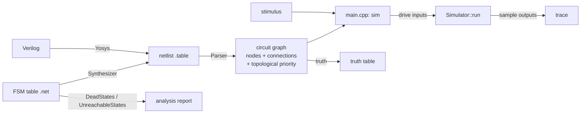

# Architecture overview

## Components

| Component | Code | Job |
|---|---|---|
| Command line | `main.cpp` | Parses arguments, reads the stimulus, drives the simulator, writes the trace and statistics. See [cli.md](../cli.md). |
| Parser | `parser/` | Reads a netlist, checks it, creates one node per cell and per primary bit, connects them, and gives every node a topological priority. See [parser.md](../parser.md). |
| Nodes | `core/`, `combinational/`, `sequential/`, `primary/` | The circuit graph. Each node holds its output value and a list of the nodes it drives. See [nodes.md](nodes.md). |
| Operations | `operations/` | Small work items, such as "evaluate this node's port with this value", that the simulator queues and runs. |
| Simulator | `simulation/` | Owns the nodes and the three queues, and runs them until the circuit settles. See [simulation.md](simulation.md). |
| Synthesizer | `synthesizer/` | Turns an FSM table into a netlist, and finds dead and unreachable states. See [synthesizer/](../synthesizer/synthesizer.md). |

Everything except `main.cpp` is built into `libhdlsim.a`, which the command line and the tests link against.

## Simulator state

`Simulator` has only static members. There is one circuit per process:

| Member | Holds |
|---|---|
| `nodes` | Every node, owned through `unique_ptr`, in topological order |
| `primaryInputs`, `primaryOutputs` | Port name → its bit nodes, LSB first |
| `combinationalQueue` | Pending `EvaluateOperation`s: a value arriving at a node's input |
| `topologicalQueue` | Nodes whose output changed and has not been passed on yet, ordered by priority |
| `sequentialQueue` | Pending flip-flop clock edges (`ChangeStateOperation`) and flip-flop output updates (`CommitOperation`) |
| `stats` | Counters of work done, for `-p` |

`Simulator::clear()` empties all of it, so another netlist can be loaded. The test runner forks every test, so tests never see each other's state.

## The life of one `sim` run

1. **Parse.** `Simulator::parse` → `Parser::parse` builds the nodes, the connections and the priorities.
2. **Read the stimulus.** `main.cpp` maps every header entry to its input nodes, MSB first.
3. **Initialize.** `Simulator::initialize` drives every input to 0, queues every node for a commit, and runs. Every node, including the gates that output 1 when all their inputs are 0, now holds a value consistent with its inputs.
4. **For each stimulus row:**
   1. Call `evaluate(Port::O, value)` on each input node. A node whose value changed passes it on to the nodes it drives.
   2. Call `Simulator::run()` until all three queues are empty.
   3. Read `getResult()` from each output node.
5. **Write** the sampled outputs as the trace.

How `run()` orders the work, so that every gate sees its final inputs and every flip-flop samples at the right moment, is in [simulation.md](simulation.md).

## Assumptions

- **Two values only.** A signal is `LOW` or `HIGH`. There is no `X` or `Z`. Every node starts at `LOW`, and every flip-flop powers up at 0.
- **Zero delay.** Gates have no propagation delay. A stimulus row is one instant in which the whole circuit settles.
- **Edge-triggered storage only.** There are no latches and no asynchronous set or reset. A combinational loop is rejected when the netlist is loaded.
- **One flattened module** per netlist.

Why these were chosen, and what they cost, is in [decisions.md](decisions.md).
