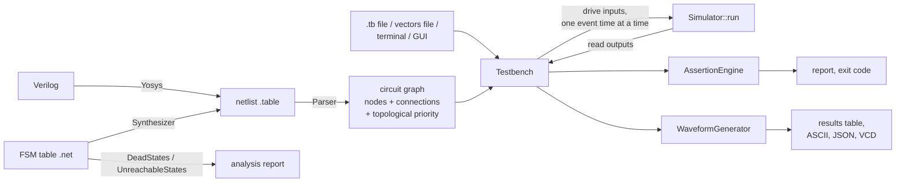

# Architecture overview

## Layers

The code is in three layers, which follow the three worklets:

| Layer | Worklet | Code | Job |
|---|---|---|---|
| Engine | 1 and 2 | `core/`, `combinational/`, `sequential/`, `primary/`, `operations/`, `simulation/` | The circuit graph and the algorithm that settles it. Knows nothing about time or files |
| Front ends to the engine | 1 and 2 | `parser/`, `synthesizer/` | Build the graph from a netlist, or a netlist from an FSM table |
| Verification and I/O | 3 | `testbench/`, `assertion/`, `waveform/`, `main.cpp`, `gui/` | Time, stimulus, clocks, checks, output files, the CLI and the GUI |

Each layer only calls the one below it. The engine has no idea that a testbench exists, so the same engine is driven by `--testbench`, `--interactive`, `--truthtable`, the GUI and the tests.

## Components

| Component | Code | Job |
|---|---|---|
| Command line | `main.cpp` | The menu and the `--` options. Reads vectors files. See [cli.md](../cli.md) |
| Parser | `parser/` | Reads a netlist, checks it, creates one node per cell and per primary bit, connects them, and gives every node a topological priority. See [parser.md](../parser.md) |
| Nodes | `core/`, `combinational/`, `sequential/`, `primary/` | The circuit graph. Each node holds its output value and a list of the nodes it drives. See [nodes.md](nodes.md) |
| Operations | `operations/` | Small work items, such as "evaluate this node's port with this value", that the simulator queues and runs |
| Simulator | `simulation/` | Owns the nodes and the three queues, and runs them until the circuit settles. See [simulation.md](simulation.md) |
| Synthesizer | `synthesizer/` | Turns an FSM table into a netlist, and finds dead and unreachable states. See [synthesizer/](../synthesizer/synthesizer.md) |
| Testbench | `testbench/Testbench` | Loads a circuit, holds the stimulus, clock and assertions, and steps the simulator through time. See [testbench.md](testbench.md) |
| Assertion engine | `assertion/` | Records each assertion and invariant check, and prints the report |
| Waveform generator | `waveform/` | Keeps a snapshot of every primary bit at every event time, and writes the four output files. See [formats/output.md](../formats/output.md) |
| Test suite | `testbench/TestSuite`, `tests/<category>/` | The 7 test categories run by `--test`. See [testing.md](../testing.md) |
| GUI | `gui/` | Browser page and Python server that writes testbenches and runs `./simulator --testbench`. See [gui.md](../gui.md) |

## Simulator state

`Simulator` has only static members. There is one circuit per process:

| Member | Holds |
|---|---|
| `nodes` | Every node, owned through `unique_ptr`, in topological order |
| `primaryInputs`, `primaryOutputs` | Port name → its bit nodes, LSB first |
| `combinationalQueue` | Pending `EvaluateOperation`s: a value arriving at a node's input |
| `topologicalQueue` | Nodes whose output changed and has not been passed on yet, ordered by priority |
| `sequentialQueue` | Pending flip-flop clock edges (`ChangeStateOperation`) and flip-flop output updates (`CommitOperation`) |

`Simulator::clear()` empties all of it, so another netlist can be loaded. Loading a circuit into a `Testbench` calls it first.

The engine's API is small:

| Call | Does |
|---|---|
| `Simulator::synthesize(path)` | FSM table → netlist file. Returns its path, or `""` |
| `Simulator::parse(path)` | Netlist → graph. Returns 0, or -1 on error |
| `Simulator::initialize()` | Drives every input to 0 and settles every node |
| `node->evaluate(Port::O, value)` on input nodes | Drives inputs |
| `Simulator::run()` | Settles the circuit |
| `node->getResult()` on output nodes | Reads outputs |
| `Simulator::generateTruthTable(path)` | Every input combination of a combinational circuit |

## The life of one `--testbench` run

1. **Load.** `Testbench::loadTestbenchFile` reads the directives. `CIRCUIT`/`NETLIST`/`FSM` calls `loadCircuit`: synthesize if it is an FSM table, then `Simulator::parse`, then register every primary bit with the waveform.
2. **Collect event times.** 0, every stimulus and assertion time, and every clock edge up to `MAX_TIME`.
3. **Initialize.** `Simulator::initialize()`.
4. **For each event time:** set the clock, apply that time's stimuli, `Simulator::run()`, record a snapshot, check that time's assertions, check every invariant.
5. **Report and export.** Print the waveform and the assertion report, and write the four output files.

`--interactive` is the same, except that `main.cpp` turns each vectors row into stimuli (and expected outputs into assertions) at 10-unit steps instead of reading a `.tb` file. Details are in [testbench.md](testbench.md).

## Assumptions

- **Two values only.** A signal is `LOW` or `HIGH`. There is no `X` or `Z`. Every node starts at `LOW`, and every flip-flop powers up at 0.
- **Zero delay.** Gates have no propagation delay. An event time is one instant in which the whole circuit settles.
- **Edge-triggered storage only.** There are no latches and no asynchronous set or reset. A combinational loop is rejected when the netlist is loaded.
- **One flattened module** per netlist.

Why these were chosen, and what they cost, is in [decisions.md](decisions.md).
