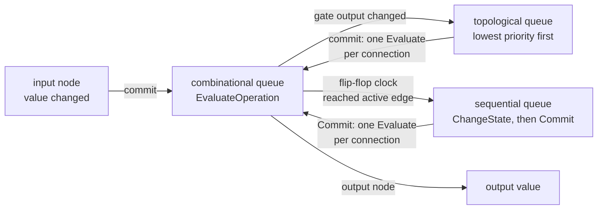

# Simulation algorithm

The code is `Simulator::run()` in `src/simulation/Simulator.cpp`. It is called once per stimulus row, after the changed inputs have been driven, and returns when the circuit has settled.

## The three queues

| Queue | Holds | Order |
|---|---|---|
| Combinational | `EvaluateOperation`: a value arriving at a node's input port | FIFO |
| Topological | Nodes whose output changed but has not been passed on | Lowest priority first, each node at most once |
| Sequential | `ChangeStateOperation` (a flip-flop saw its active edge), then `CommitOperation` (a flip-flop's Q changed) | FIFO |

How work moves between them:



A flip-flop's data input only stores the value, and queues nothing.

## `run()`

```
while any queue is not empty:
    run every combinational operation                    # gates update their own output only

    while the combinational or topological queue is not empty:
        commit the lowest-priority node in the topological queue
        run every combinational operation it caused

    run every sequential operation                       # edges first, then the Q updates they cause
```

The three counters in `--perf` statistics count these steps: `comb_ops` counts combinational operations, `commits` counts topological commits, and `seq_ops` counts sequential operations.

## Why gates are committed in topological order

The parser gives every node a **priority**, which is its position in a topological order of the combinational graph (see [parser.md](../parser.md#5-topological-order)). A node always has a higher priority than every node that drives it, through gates.

When a gate's inputs change, `evaluate` updates its `result` and puts it in the topological queue, but it does not pass the value on yet. The inner loop then always commits the queued node with the **lowest** priority. That gives three properties:

- **A node is committed only after every changed node before it has been committed.** Committing a node can only queue nodes after it, so when node `n` is taken from the queue, nothing that drives `n` can still change in this wave.
- **Each node is committed at most once per wave, with its final value.** The queue is a set, so repeated changes to the same node merge into one entry.
- **No glitches pass through.** Consider `y = a XOR b` while `a` and `b` both flip. The XOR is evaluated twice, but it commits once, after both inputs have arrived, so the nodes it drives never see the in-between value.

The cost is a `std::set` insert and remove per changed node, which is O(log k) for k queued nodes. Gates that do not change are never queued, so the work in a row is proportional to the activity in that row, not to the size of the circuit.

## Clock edges

A flip-flop's data inputs are excluded from the topological order. Its clock input is not, so a flip-flop comes after the logic that drives its clock.

When a combinational wave moves a flip-flop's clock to the active edge, the flip-flop queues a `ChangeStateOperation`. It does not change Q at that point. The sequential queue runs only after the combinational and topological queues are empty, so:

1. **Every flip-flop samples settled data.** All logic feeding the data inputs has finished this wave.
2. **All flip-flops clocked in the same wave update together.** All `ChangeStateOperation`s are queued before any of them runs. Each one that changes Q appends a `CommitOperation` behind them, so every flip-flop computes its next state from the **old** values of the others before any new Q is passed on. That is the behavior of nonblocking assignment, and it is what makes a shift register shift by one position per edge.

The `CommitOperation`s then pass the new Q values into the combinational queue, and the outer loop goes around again to settle the logic after the flip-flops.

### Derived clocks

If that logic drives another flip-flop's clock, as in a ripple counter, a clock divider or a gated clock, the next pass queues that flip-flop's edge and handles it the same way. One `run()` therefore handles any chain of derived clocks. The loop ends when a pass causes no new work, and it always ends because the circuit has no combinational cycles. The validation circuits `23_ripplecounter`, `24_clockdivider`, `25_gatedclock` and `26_gatedclockflop` test these cases.

## Initialization

`Simulator::initialize()` runs once after parsing:

1. Drive every input node to 0.
2. Put **every** node in the topological queue.
3. `run()`.

Every node then commits once, in topological order, so every gate is evaluated with real input values. A NOT gate fed by 0 ends at 1, even though every node is created with `result = LOW`. Constant drivers pass on their values in the same way.

A flip-flop's `initialized` flag is set when it commits for the first time. Until then, clock changes only record the level, so initialization never counts as a clock edge. Its clock source has a lower priority, so the flip-flop has recorded the initial clock level before it commits.

## A worked example

A 2-bit shift register: `d → FF0 → FF1 → q`, with both flip-flops clocked by `clk`. It starts with FF0 = 1, FF1 = 0, `clk = 0` and `d = 0`, and the next row raises `clk` only:

| Step | Queue run | What happens |
|---|---|---|
| Drive inputs | n/a | Only `clk` changed, so its input node commits: Evaluate(FF0.CLK, 1), Evaluate(FF1.CLK, 1) |
| 1 | combinational | FF0 and FF1 each see a rising edge and queue a ChangeState |
| 2 | topological | empty: no gate changed |
| 3 | sequential | ChangeState(FF0): Q 1 → 0, queue Commit(FF0). ChangeState(FF1): samples FF1.D = 1 (FF0's **old** Q), so Q 0 → 1, queue Commit(FF1). Then both Commits run: Evaluate(FF1.D, 0), Evaluate(q, 1) |
| 4 | combinational | FF1 stores `d = 0`, and the output node becomes 1 |
| | | All queues are empty, so `run()` returns. `q` = 1 |

## Cost

Per row the work is about `changed nodes × (fanout + log k)`. The per-row cost does not depend on circuit size directly.
