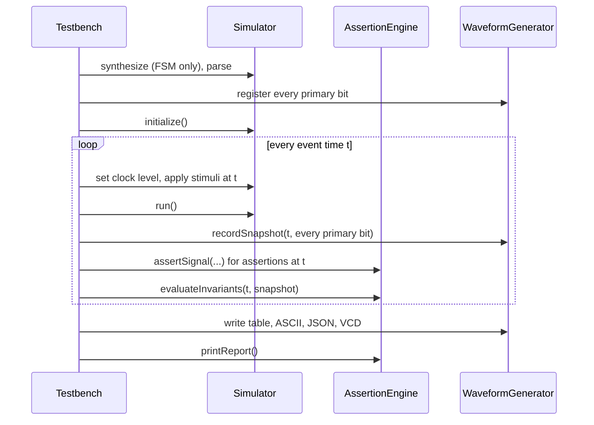

# Testbench engine

`slms::Testbench` (`src/testbench/Testbench.cpp`) adds time to the engine. The engine settles a circuit for one instant; the testbench decides which instants exist, what changes at each, and what to check afterwards. It owns an `AssertionEngine` and a `WaveformGenerator`.

## Interface

| Call | Does |
|---|---|
| `loadCircuit(path)` | Clears the simulator. If the file looks like an FSM table, synthesizes it. Parses the netlist and registers every primary bit with the waveform |
| `loadTestbenchFile(path)` | Reads a `.tb` file and calls the methods below. See [formats/testbench.md](../formats/testbench.md) |
| `setClock(name, period, low_time)` | Turns on the clock |
| `addStimulus(t, name, value, bit = -1)` | Sets an input (or one bit of it, from C++) at time `t` |
| `addAssertion(t, name, expected, msg, bit = -1)` | Checks an output (or one bit) at time `t` |
| `addInvariant(name, fn, desc)` | A check run at every event time against the snapshot |
| `setMaxTime(t)` | Last time simulated |
| `run()` | Runs the simulation. Returns true when every check passed |
| `exportTable`, `exportWaveform`, `exportJSON`, `exportVCD` | The output files |
| `printReport()` | ASCII waveform and assertion report |

C++ callers can drive single bits with `bit`; the `.tb` reader always passes -1 (every bit). `main.cpp` uses `bit` for vectors files, which is why `--interactive` can drive bus bits and `--testbench` cannot.

## `run()`

1. **Event times.** A sorted set of 0, every stimulus time and every assertion time up to `MAX_TIME`. With a clock, also every falling edge `k × period`, every rising edge `k × period + low_time`, and `MAX_TIME`.
2. **Sort stimuli by time** once, and keep a cursor into that list. Each event time applies only its own stimuli, in the order they were added.
3. `Simulator::initialize()`.
4. **For each event time `t`:**
   1. With a clock, apply its level at `t`: LOW while `t mod period < low_time`, HIGH after.
   2. Apply the stimuli at `t`.
   3. `Simulator::run()`.
   4. Build a snapshot, a map from signal name (`q[0]` for bus bits) to value, of every primary input and output. Hand it to the waveform.
   5. Check every assertion whose time is `t`, reading the output nodes directly.
   6. Evaluate every invariant on the snapshot.
5. Any unknown signal or bad bit index throws inside the loop. `run()` catches it, prints `Simulation failed: ...` and returns false.

## How `--interactive` uses it

`main.cpp` loads the circuit with `loadCircuit`, then lists the inputs as `(name, bit)` pairs sorted by name and bit. Each vectors row `k` becomes one `addStimulus(10k, name, value, bit)` per input bit, and with a `# columns:` header, one `addAssertion(10k, ...)` per output bit. It sets `MAX_TIME` to `10 × rows + 5`, runs, and writes the `interactive_*` files.

## Assertion engine

`AssertionEngine` keeps one record per check: id, time, type (`VALUE_EQUAL` or `INVARIANT`), name, expected and actual value, pass or fail, message. The report counts them and lists every failure. It has no knowledge of the circuit; the testbench reads the values and passes them in.

`INVARIANT` expressions are parsed by a small recursive-descent parser in `Testbench.cpp` (`BooleanExpression`): `!`, `&&`, `||`, parentheses, `== 0/1`, `!= 0/1`, and bare names.

## Waveform generator

`WaveformGenerator` keeps the list of signal names and a map from time to snapshot. Every output format is written from that map. See [formats/output.md](../formats/output.md).

## Cost

Per event time, on top of the engine's work:

| Work | Cost |
|---|---|
| Building the snapshot | One string-keyed map entry per primary bit |
| Keeping it for the output files | Every snapshot is kept until the run ends, so memory grows with event times × primary bits |
| Checking assertions | A scan of the whole assertion list, to find those at `t` |
| Invariants | One expression evaluation each |

On small circuits with wide buses this, not the gates, sets the run time, and on long runs it sets the memory: 1.28 GB at 90,000 rows on a circuit with 129 primary bits (see [benchmarks.md](../benchmarks.md#cost-of-the-interface)).

## The 7-category test suite

`slms::TestSuite` (`src/testbench/TestSuite.cpp`) runs the tests behind `--test`. Each category lives in `tests/<category>/Test<Category>.cpp` and records results with `record(category, name, passed, details)`. See [testing.md](../testing.md).
