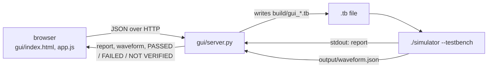

# Web GUI

A browser front end for the simulator. It is not a second logic engine: every result on the page comes from running `./simulator --testbench` on a testbench the server writes.

```sh
make
./simulator --gui 8080          # or: python3 gui/server.py 8080
```

Open `http://localhost:8080`. Start it from the project root, after `make`, because the server runs `./simulator` and resolves paths from there. The terminal logs each request. The simulator's own output and errors are shown in the page.



The server uses only the Python standard library. It listens on every network interface (`0.0.0.0`) and has no login, so run it only on a trusted network.

## Panels

### Traffic Light FSM (live)

Steps the traffic-light FSM (`tests/netlists/fsm/traffic_light/traffic_light_fsm.net`) one clock at a time.

- **Enable (en)** and **Reset (reset)** set the inputs for the next tick.
- **Step Clock (Tick)** runs one more clock cycle. **Auto Clock** keeps ticking. **Reset** clears the history and returns to Green.
- The lamps show the current state, and the waveform viewer adds two new samples per tick: the low and high halves of the clock. Future values are never drawn.
- **Traffic-light checks** shows three live checks on the samples: Red and Green never together, exactly one lamp lit, and the order Green → Yellow → Red → Green.

The simulator does not keep running between requests. For each tick the server replays the whole input history so far, from reset, through a fresh `./simulator --testbench` run, and returns only the samples of the new tick. A session is limited to 200 ticks.

### Circuit Workbench

Runs any of the 18 bundled example circuits with its reference testbench:

| Category | Circuits |
|---|---|
| Combinational | AND, AND-NOT, MUX, NAND, NOR, NOT, OR, OR-NOT, XOR |
| Sequential | D, JK and T flip-flops, each positive and negative edge; 4-bit shift register |
| FSM | Traffic light, vending machine |

Choosing a circuit fills in its netlist path, maximum time, clock period, and the stimulus and assertions from its `examples/component_file_io/.../testbench.tb`. Everything can be edited before **Run selected circuit**. **Restore reference testbench** puts the original back.

The editor accepts:

```
@0 a=0 b=1               timed input change (also written 0: a=0 b=1)
@10 a=1 b=1 | y=1        input change, then expected outputs after |
ASSERT @12 y=1 "msg"     the testbench's own assertion
INVARIANT name expr "d"  the testbench's own invariant
```

The netlist must be inside the project folder. The result shows the generated testbench, the simulator's report, the waveform, and one of three verdicts:

| Verdict | Meaning |
|---|---|
| `PASSED` | At least one assertion was checked, and none failed |
| `FAILED` | At least one assertion or invariant failed |
| `NOT VERIFIED` | The simulation ran, but there were no assertions to check |

### Vending Machine

**Insert 5** and **Insert 10** add a coin to the session and replay the whole coin sequence through `examples/vending_machine/vending_machine.net`. The server adds an assertion for the expected response to each coin, so every run reports `PASSED` or `FAILED`. The readout shows `vend` and the stored 5-unit credit after the last coin. **Reset session** clears the coins and the display without running the simulator. A session holds up to 50 coins.

The FSM sells a 10-unit item: 10 vends at once, 5 then 5 vends on the second coin. It has no change return or product choice.

### Automated Test Suite

**Run All Test Categories** runs `./simulator --test all` and lists every test with its category and result (30 tests, see [testing.md](testing.md)).

### Advanced: custom testbench and downloads

- Type or paste a `.tb` testbench, or load one with **Browse / Upload .tb file**. Its circuit path must exist in the project.
- To run a netlist that is not in the project, also choose it with **Browse / Upload netlist**. The server saves it under `build/` for that run, and replaces the testbench's `CIRCUIT`, `NETLIST` or `FSM` line with it, or adds one. A netlist that refers to other files cannot be uploaded this way.
- **Run this testbench** runs it. **Download VCD / TXT / JSON** saves the last waveform.

Files are limited to 1 MB each.

## HTTP API

All bodies are JSON. Every simulation request runs while holding one lock, because every run writes the same files in `output/`.

| Method and path | Request | Does |
|---|---|---|
| `GET /api/catalog` | | Lists the bundled circuits with their netlist, testbench, maximum time, clock period and stimulus text. Entries whose files are missing are left out |
| `POST /api/live` | `{session, action: "reset" \| "step", en, reset}` | One tick of the live traffic light. Returns the new samples |
| `POST /api/generic-simulate` | `{circuitType: "netlist" \| "fsm", netlist, maxTime, clockPeriod, stimuli}` | The Circuit Workbench. Returns the generated testbench, report, waveform, `verification` and assertion counts |
| `POST /api/vending` | `{coins: [5, 10, ...]}` | The vending machine. Returns `vend`, `credit5`, `verification` and the waveform |
| `POST /api/simulate` | `{testbench}` | Runs a testbench as written. Returns stdout, stderr and the waveform |
| `POST /api/file-simulate` | `{testbench, netlistName, netlistContent}` | Runs a testbench against an uploaded netlist |
| `GET /api/tests` | | Runs the test suite. Returns `{total, passed, failed, tests}` |

Any other path is served from `gui/` as a static file.

## Limits

| Limit | Value |
|---|---|
| Request size | 1 MB (3 MB for `/api/file-simulate`) |
| Live ticks per session | 200 |
| Coins per vending session | 50 |
| Input lines in the Circuit Workbench | 500 |
| Maximum time | 1 to 100,000 |
| Clock period | 2 to 10,000 |
| Simulator time-out | 20 s per run (35 s for uploads, 30 s for a live tick, 10 s for the test suite) |

## Troubleshooting

- **The page loads but nothing runs.** `./simulator` is missing. Run `make`, then restart the server.
- **`Netlist file not found inside the project`.** Use a project-relative path such as `examples/component_file_io/combinational/and/netlist.table`.
- **`Unknown primary input`.** A signal name in the editor does not match the circuit. Names are case sensitive.
- **Old page after an update.** Hard-refresh with Ctrl+Shift+R.
