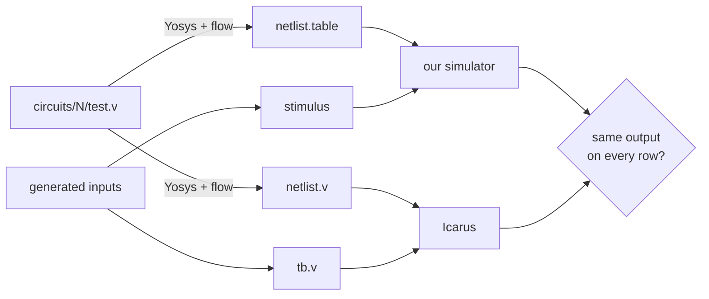

# Validation

The unit tests check the simulator against our own understanding. Validation checks it against an established simulator, [Icarus Verilog](https://github.com/steveicarus/iverilog), on the same circuits.

## Simulator

### Method



1. **One netlist, two formats.** Yosys synthesizes each `validation/circuits/<n>/test.v` once and writes the result as `netlist.table` for us and `netlist.v` for Icarus. Both simulators run the **same** gates, so a difference can only come from simulation, not from synthesis.
2. **The same inputs.** The script generates rows of input values, then writes them as a stimulus file for us and as a Verilog testbench for Icarus. The testbench prints the outputs in our trace format.
3. **Compare** the two outputs row by row as text.

The Verilog source is not simulated directly. Comparing it with its netlist would test Yosys, and it depends on how `x` and initial values are treated.

### Flows

Each run uses one Yosys script from `validation/flows/`:

| Flow | Cells produced | Why |
|---|---|---|
| `abc` (default) | AND, NAND, OR, NOR, XOR, ANDNOT, ORNOT, MUX, NOT, DFF_P, DFF_N | Exercises every gate type |
| `techmap` | AND, OR, NOT, XOR, MUX, DFF_P, DFF_N | Keeps the netlist close to the source. Different structure, same function |

Both end with `setundef -zero` and `setundef -init -zero`, so every undefined value and every flip-flop's initial value is 0, as in our simulator. Icarus then has no `x` to propagate, and both simulators start in the same state. This assumes the power-up state rather than validating it.

Running both matters: only `abc` produces NAND, NOR, ANDNOT and ORNOT, so a bug in one of those gates can show up only there.

### Inputs

| Circuit kind | Rows |
|---|---|
| Combinational, ≤ 12 input bits | Every input combination, then 300 random rows |
| Combinational, more bits | 300 random rows |
| Sequential (has `clk` or `clock`) | 300 cycles of 3 rows: `(clk=0, new data)`, `(clk=1, same)`, `(clk=0, same)` |

In sequential circuits, an input named `rst` or `reset` is held high for the first 4 cycles and then raised on 1 cycle in 16. Data changes only while the clock is low, so no edge of either polarity sees moving data. The script checks this and refuses to run a stimulus that breaks it (see [why](architecture/decisions.md#data-inputs-set-immediately-no-hold-time-check)).

Each circuit runs with 3 seeds.

### Circuits

26 circuits in `validation/circuits/`:

| Group | Circuits |
|---|---|
| Combinational | boolean, mux, mux4, mux8, mux16, 2-to-4 decoder, encoder, comparator, adder, subtractor, ALU, arbitrary logic |
| Flip-flops | positive and negative edge D flip-flop |
| Registers and counters | shift register, parallel register, binary up counter, up/down counter, ring counter |
| State machines | traffic light, sequence detector, vending machine |
| Derived and gated clocks | ripple counter, clock divider, gated clock, flip-flop clocked by a gated clock |

### Results

Run on 2026-11-04 with commit `34cf17f`, Yosys 0.68+112 and Icarus Verilog 12.0:

```sh
python3 validation/icarus/validate.py                  # abc
python3 validation/icarus/validate.py --flow techmap
```

| Flow | Circuits passed | Rows compared | Mismatched rows |
|---|---|---|---|
| `abc` | 26 / 26 | 62,676 | 0 |
| `techmap` | 26 / 26 | 62,676 | 0 |

Every row matched in both flows. The benchmark circuits, up to 256k cells, also match Icarus on every case (see [benchmarks.md](benchmarks.md#correctness)).

### What this does not cover

- **T and JK flip-flops.** Yosys has no cells for them, so they never appear in a Yosys netlist. They are tested by unit tests against reference models (`tests/unit/sequential/test_flipflops.cpp`).
- **Hold-time violations.** Rows that change data with an active edge are excluded by design. Icarus does not follow one rule for them, so there is no reference to compare with. Our behavior in that case is defined in [formats/stimulus.md](formats/stimulus.md#what-the-simulator-does).
- **Power-up state.** Both simulators are told that everything starts at 0.

### Running it

```sh
make
python3 validation/icarus/validate.py                   # every circuit, abc flow
python3 validation/icarus/validate.py mux counter       # circuits whose name contains "mux" or "counter"
python3 validation/icarus/validate.py --flow techmap --seeds 5 --cycles 1000
```

Generated files go to `validation/icarus/out/<circuit>/<flow>/`. When a circuit fails, the files of the failing seed stay there for debugging. The script exits 1 on any failure. How to write a new circuit is in `validation/README.md`.

## Synthesizer

The FSM table is the reference. `validation/synthesizer/validate.py` reads the table and the netlist itself and shares no code with the synthesizer, the parser or the simulator.

### Method

Each FSM gets three checks:

| Check | What it does | What it shows |
|---|---|---|
| Structure | Only documented cells, one driver per wire, no loops, the expected flip-flops and state encoding, and `simulator ports` accepts the netlist | The netlist is well formed |
| Walk | Starts the table and the circuit at reset, and tries every input value with `reset` at 0 and 1 in each state reached, comparing outputs | The state and inputs fully decide what happens next, so a match here covers every input sequence of any length |
| Forced | Sets the flip-flops directly to every value | Unreachable states match their rows, and unused codes output zeros and go to reset |

FSMs where no row sets any bit to 1 must be rejected, because no gate would read their inputs.

To show that the checks can fail, the script then damages netlists (wrong gate type, inverted or rewired input, held or swapped flip-flops, swapped outputs) and tables (flipped output, wrong next state, removed row). Each damaged version must be noticed, unless the damaged netlist still computes the same function, which is counted as harmless.

### FSMs

| Group | Contents |
|---|---|
| `edge` | The examples in `docs/fsm_example/` and the unusual cases in `validation/synthesizer/fsms/`: one state, no inputs, no outputs, reset state with no rows or not listed first, identical outputs, a two-state trap, format variations, and FSMs that must be rejected |
| `tiny` | Every possible table of each small shape, up to 4 states with no inputs, or 1 state with 2 inputs. `--full` adds larger shapes |
| `random` | Random tables: `full`, `sparse`, `power_of_two` (2 to 65 states), `unreachable`, `traps`, `output_density`, `many_outputs` (up to 200), `many_states` (up to 1,024) and `wide` (up to 128 inputs) |

FSMs with more than 16 bits of state, inputs and reset cannot try every input. They try each listed input value, the same value with each single bit flipped, and 64 random values. These are the FSMs reported as sampled.

### Results

Run on 2026-11-04 on commit `ffa0a5f`, with Python 3.14.7. `validate.py` itself was not yet committed.

| Command | FSMs | Tried every input | Sampled | Rejected as expected | Checks | Mismatches |
|---|---|---|---|---|---|---|
| `validate.py` | 2,139 | 1,999 | 12 | 128 | 1,570,472 | 0 |
| `validate.py tiny --full` | 15,745 | 15,331 | 0 | 414 | 310,672 | 0 |

Of the damaged netlists and tables in the first run, 7,268 were noticed by the walk and 1,076 only by the forced check. Another 39 still computed the same function, and none were missed.

`validation/synthesizer/inject_bugs.py` also checks the script against real code mistakes. It builds 12 copies of the synthesizer, each with one bug in `Synthesizer.cpp`, and `validate.py` must fail on all of them. All 12 were caught. One bug only appears with 10 or more inputs, and only the `wide` family caught it, which is why the FSMs vary in kind as well as in number.

These runs and the `synthesizer` unit tests together execute every line of `Synthesizer.cpp`. The unit tests supply the error handling, the code that writes the file and the module name clean-up.

### What this does not cover

- **Simulating the netlist.** The script evaluates the gates itself. The `fsm_flow` tests run netlists through our parser and simulator. Synthesized netlists are not compared with Icarus, because the Icarus validation above already covers the simulator on these gate types.
- **Dead and unreachable states.** `DeadStates` and `UnreachableStates` are not validated here.
- **FSMs that are sampled.** These are spot checks, not a proof, and hold only for the inputs tried.
- **Gate count.** A correct netlist with wasteful gates passes.
- **Our reading of the format.** The script and the synthesizer follow the same documented rules, such as a missing row going to reset. A mistake in those rules would pass both.
- **Other FSMs.** A pass proves each tested FSM with every input tried. It does not prove the code correct for FSMs that were not tested.

### Running it

```sh
make
python3 validation/synthesizer/validate.py                 # everything, about a minute
python3 validation/synthesizer/validate.py edge wide       # groups whose name contains "edge" or "wide"
python3 validation/synthesizer/validate.py --seeds 10 --mutants 100
python3 validation/synthesizer/validate.py --full          # more tiny FSMs, a few minutes
python3 validation/synthesizer/inject_bugs.py              # the 12 bugs, about a minute
```

If `Synthesizer.cpp` changes, `inject_bugs.py` stops and names any bug whose line no longer matches, so its entry in `BUGS` can be updated.

The script exits 1 on any failure and keeps the failing FSM in `validation/synthesizer/out/failures/`.
