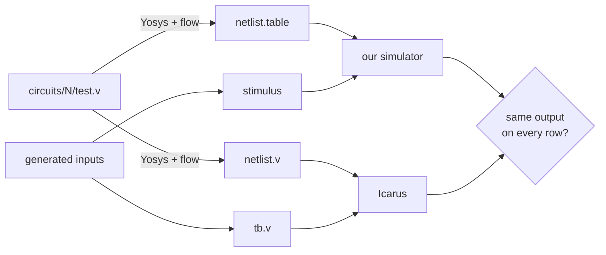

# Validation

The unit tests check the simulator against our own understanding. Validation checks it against an established simulator, [Icarus Verilog](https://github.com/steveicarus/iverilog), on the same circuits.

## Simulator

### Method



1. **One netlist, two formats.** Yosys synthesizes each `validation/circuits/<n>/test.v` once and writes the result as `netlist.table` for us and `netlist.v` for Icarus. Both simulators run the **same** gates, so a difference can only come from simulation, not from synthesis.
2. **The same inputs.** The script generates rows of input values, then writes them as a stimulus file for us and as a Verilog testbench for Icarus. The testbench prints the outputs in our trace format.
3. **Compare** the two outputs row by row as text.

The Verilog source is not simulated directly. Comparing it with its netlist would test Yosys, and it depends on how `x` and initial values are treated.

### Flows

Each run uses one Yosys script from `validation/flows/`:

| Flow | Cells produced | Why |
|---|---|---|
| `abc` (default) | AND, NAND, OR, NOR, XOR, ANDNOT, ORNOT, MUX, NOT, DFF_P, DFF_N | Exercises every gate type |
| `techmap` | AND, OR, NOT, XOR, MUX, DFF_P, DFF_N | Keeps the netlist close to the source. Different structure, same function |

Both end with `setundef -zero` and `setundef -init -zero`, so every undefined value and every flip-flop's initial value is 0, as in our simulator. Icarus then has no `x` to propagate, and both simulators start in the same state. This assumes the power-up state rather than validating it.

Running both matters: only `abc` produces NAND, NOR, ANDNOT and ORNOT, so a bug in one of those gates can show up only there.

### Inputs

| Circuit kind | Rows |
|---|---|
| Combinational, ≤ 12 input bits | Every input combination, then 300 random rows |
| Combinational, more bits | 300 random rows |
| Sequential (has `clk` or `clock`) | 300 cycles of 3 rows: `(clk=0, new data)`, `(clk=1, same)`, `(clk=0, same)` |

In sequential circuits, an input named `rst` or `reset` is held high for the first 4 cycles and then raised on 1 cycle in 16. Data changes only while the clock is low, so no edge of either polarity sees moving data. The script checks this and refuses to run a stimulus that breaks it (see [why](architecture/decisions.md#data-inputs-set-immediately-no-hold-time-check)).

Each circuit runs with 3 seeds.

### Circuits

26 circuits in `validation/circuits/`:

| Group | Circuits |
|---|---|
| Combinational | boolean, mux, mux4, mux8, mux16, 2-to-4 decoder, encoder, comparator, adder, subtractor, ALU, arbitrary logic |
| Flip-flops | positive and negative edge D flip-flop |
| Registers and counters | shift register, parallel register, binary up counter, up/down counter, ring counter |
| State machines | traffic light, sequence detector, vending machine |
| Derived and gated clocks | ripple counter, clock divider, gated clock, flip-flop clocked by a gated clock |

### Results

Run on 2026-11-04 with commit `34cf17f`, Yosys 0.68+112 and Icarus Verilog 12.0:

```sh
python3 validation/icarus/validate.py                  # abc
python3 validation/icarus/validate.py --flow techmap
```

| Flow | Circuits passed | Rows compared | Mismatched rows |
|---|---|---|---|
| `abc` | 26 / 26 | 62,676 | 0 |
| `techmap` | 26 / 26 | 62,676 | 0 |

Every row matched in both flows. The benchmark circuits, up to 256k cells, also match Icarus on every case (see [benchmarks.md](benchmarks.md#correctness)).

### What this does not cover

- **T and JK flip-flops.** Yosys has no cells for them, so they never appear in a Yosys netlist. They are tested by unit tests against reference models (`tests/unit/sequential/test_flipflops.cpp`).
- **Hold-time violations.** Rows that change data with an active edge are excluded by design. Icarus does not follow one rule for them, so there is no reference to compare with. Our behavior in that case is defined in [formats/stimulus.md](formats/stimulus.md#what-the-simulator-does).
- **Power-up state.** Both simulators are told that everything starts at 0.

### Running it

```sh
make
python3 validation/icarus/validate.py                   # every circuit, abc flow
python3 validation/icarus/validate.py mux counter       # circuits whose name contains "mux" or "counter"
python3 validation/icarus/validate.py --flow techmap --seeds 5 --cycles 1000
```

Generated files go to `validation/icarus/out/<circuit>/<flow>/`. When a circuit fails, the files of the failing seed stay there for debugging. The script exits 1 on any failure. How to write a new circuit is in `validation/README.md`.

## Synthesizer

> **TODO (synthesizer validation):** to be written by the synthesizer validation work. Suggested contents:
>
> - **Method:** what the synthesized netlist is compared against, as an independent reference. For example: behavioral Verilog generated from the FSM table and run in Icarus, or Yosys's own FSM extraction. Then how the stimuli are generated, including resets and missing transitions.
> - **FSMs used:** the hand-written examples and any randomly generated ones, with their sizes (states, inputs, outputs).
> - **Results:** FSMs passed, rows compared, mismatches, plus the date, commit and tool versions, in the same form as the simulator results above.
> - **Dead and unreachable states:** how `DeadStates` and `UnreachableStates` were checked, for example against a brute-force search.
> - **What it does not cover.**
> - **How to run it.**
